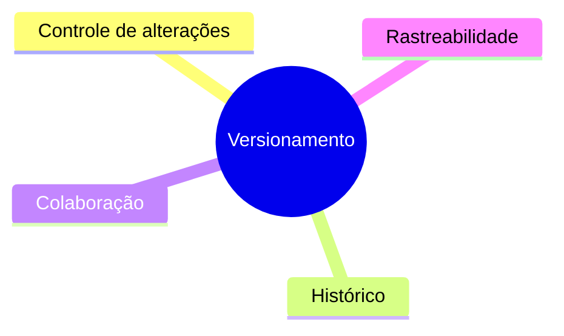
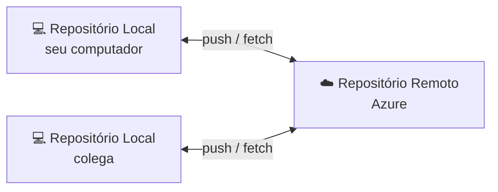
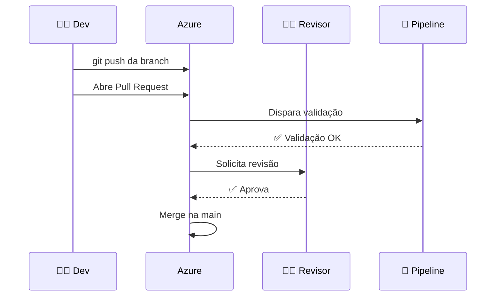
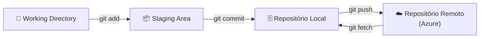
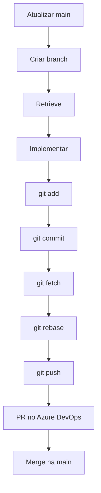
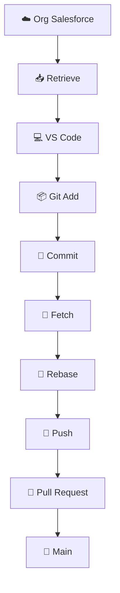

# Aula 3 Versionamento: Git e Azure DevOps em projetos Salesforce

Versionar código é como manter o diário de bordo de um navio. Cada anotação parece pequena, mas é ela que mostra de onde viemos, por onde passamos e como voltar se algo der errado.

## Sumário
- [Introdução ao Versionamento](#introdução-ao-versionamento)
- [Conceitos Fundamentais do Git](#conceitos-fundamentais-do-git)
- [Comandos Git Essenciais](#comandos-git-essenciais)
- [Retrieve no Salesforce: o que é e como funciona](#retrieve-no-salesforce-o-que-é-e-como-funciona)
- [Metadados Salesforce e package.xml](#metadados-salesforce-e-packagexml)
- [Fluxo Prático Salesforce](#fluxo-prático-salesforce)
- [Boas Práticas](#boas-práticas)
- [Erros Comuns](#erros-comuns)
- [Resumo Final](#resumo-final)

---

## Introdução ao Versionamento

### O que é versionamento de código?
Versionamento de código (controle de versão) é a prática de **registrar cada alteração** feita no projeto ao longo do tempo.

Com isso, você consegue responder:
- O que mudou?
- Quem mudou?
- Quando mudou?
- Por que mudou?

Sem versionamento, times acabam caindo no “controle manual”:

```text
classe_final.cls
classe_final_v2.cls
classe_final_v2_agora_vai.cls
classe_final_v2_agora_vai_correta.cls
```

Em projetos Salesforce com muitos metadados e várias pessoas atuando ao mesmo tempo, isso vira caos rapidamente.

---

### Problemas de não usar versionamento

| Situação | Consequência |
|----------|--------------|
| Dois devs alteram o mesmo metadata | Uma alteração sobrescreve a outra |
| Deploy quebra produção | Dificuldade de rollback |
| “Quem mexeu nisso?” | Falta de rastreabilidade |
| Refresh de sandbox | Perda de mudanças que não estavam no repositório |
| Auditoria/compliance | Falta evidência confiável de histórico |

---

### Os 4 pilares do versionamento

1. **Controle de alterações**  
   Cada mudança fica registrada e revisável.

2. **Histórico de mudanças**  
   É possível voltar no tempo e recuperar versões estáveis.

3. **Trabalho colaborativo**  
   Pessoas diferentes trabalham em paralelo com branches.

4. **Rastreabilidade**  
   Mudanças técnicas ficam ligadas a tasks/requisitos de negócio.



---

### Por que versionar Salesforce?
Porque a org guarda o **estado atual**, mas não é ideal como **fonte histórica de engenharia**.

Com Git + Azure DevOps, você ganha:
- Fonte única da verdade (`main`)
- Pull Request com revisão
- Histórico auditável
- Menos risco em deploy
- Base para CI/CD (Azure Pipelines)

---

## Conceitos Fundamentais do Git

- **Repositório:** projeto + histórico
- **Branch:** linha de trabalho isolada
- **Commit:** snapshot da alteração
- **Merge:** união de branches
- **Pull Request:** revisão antes de integrar na `main`
- **Origin/Remote:** repositório remoto (Azure Repos)
- **Conflito:** mudanças concorrentes na mesma região do arquivo





---

## Comandos Git Essenciais

### `git fetch origin`
**O que faz:** busca atualizações do remoto (Azure Repos) sem alterar seus arquivos locais.  
**Quando usar:** antes de rebase, no começo do dia.

```bash
git fetch origin
```

### `git checkout main`
**O que faz:** troca para a branch `main`.  
**Quando usar:** para atualizar base antes de começar uma nova task.

```bash
git checkout main
```

### `git checkout -b feature/...`
**O que faz:** cria uma nova branch e já entra nela.  
**Quando usar:** sempre ao iniciar uma task.

```bash
git checkout -b feature/JIRA-1234-validacao-cpf
```

### `git add <arquivo>`
**O que faz:** coloca arquivo(s) no stage (preparados para commit).  
**Quando usar:** após revisar o que foi alterado.

```bash
git add force-app/main/default/classes/AccountService.cls
```

### `git commit -m "..."`
**O que faz:** cria um snapshot local das alterações staged.  
**Quando usar:** ao finalizar uma unidade lógica de trabalho.

```bash
git commit -m "feat(account): adiciona validação de CPF"
```

### `git rebase origin/main`
**O que faz:** reaplica seus commits por cima da versão atual da `main`.  
**Quando usar:** antes de subir a branch para reduzir conflitos no PR.

```bash
git rebase origin/main
```

### `git push -u origin <branch>`
**O que faz:** envia sua branch para o remoto e cria vínculo com `origin`.  
**Quando usar:** primeira publicação da branch.

```bash
git push -u origin feature/JIRA-1234-validacao-cpf
```

### `git status` / `git diff` / `git log --oneline -5`
**O que fazem:**
- `status`: mostra estado atual dos arquivos
- `diff`: mostra o que mudou linha a linha
- `log`: mostra histórico resumido de commits

```bash
git status
git diff
git log --oneline -5
```



---

## Retrieve no Salesforce: o que é e como funciona

### O que é retrieve?
**Retrieve** é o processo de **trazer metadados da org Salesforce para o seu projeto local** (VS Code).

Em outras palavras:
- Org Salesforce = onde o sistema está rodando
- Projeto local = onde você desenvolve e versiona no Git
- Retrieve = ponte de sincronização da org para o código local

### Por que retrieve é importante?
- Garante que você está alterando a versão mais recente do metadata
- Evita desenvolver “em cima de código velho”
- Permite versionar corretamente no Git/Azure Repos
- Ajuda a identificar mudanças feitas diretamente na org

### O que retrieve **traz**?
Traz **metadados** (Apex, LWC, Flow, objetos, permission sets etc.), não registros de negócio (dados como contas e oportunidades).

### Fluxo do retrieve
1. Você informa o que quer trazer (`--metadata` ou `package.xml`)
2. O Salesforce CLI consulta a org
3. O retorno vem em formato metadata
4. O CLI converte para source format (DX)
5. Os arquivos são gravados em `force-app/...`

### Comando mais comum
```bash
sf project retrieve start --metadata ApexClass:AccountService ApexClass:AccountServiceTest
```

### Retrieve por manifesto (`package.xml`)
```bash
sf project retrieve start --manifest manifest/package.xml
```

### Boas práticas de retrieve
- Fazer retrieve **somente do necessário**
- Sempre rodar `git status` depois do retrieve
- Revisar `git diff` para validar mudanças inesperadas
- Evitar retrieve amplo que “suja” o PR

---

## Metadados Salesforce e package.xml

### O que versionar?
- Apex Classes/Triggers
- LWCs
- Objects/Fields
- Flows
- Permission Sets

### package.xml
Manifesto que define quais metadados serão recuperados/deployados.

```xml
<?xml version="1.0" encoding="UTF-8"?>
<Package xmlns="http://soap.sforce.com/2006/04/metadata">
    <types>
        <members>AccountService</members>
        <members>AccountServiceTest</members>
        <name>ApexClass</name>
    </types>
    <version>61.0</version>
</Package>
```

---

## Fluxo Prático Salesforce

1. Atualizar `main`
2. Criar branch da task
3. Retrieve do metadata da org
4. Implementar alteração
5. `git add` + `git commit`
6. `git fetch` + `git rebase origin/main`
7. `git push`
8. Abrir Pull Request no Azure DevOps

```bash
git checkout main
git fetch origin
git rebase origin/main

git checkout -b feature/JIRA-1234-validacao-cpf

sf project retrieve start --metadata ApexClass:AccountService ApexClass:AccountServiceTest

# ... altera código ...

git add force-app/main/default/classes/AccountService.cls
git add force-app/main/default/classes/AccountServiceTest.cls
git commit -m "feat(account): adiciona validação de CPF"

git fetch origin
git rebase origin/main
git push -u origin feature/JIRA-1234-validacao-cpf
```



---

## Boas Práticas

- Commits pequenos e frequentes
- Nunca trabalhar direto na `main`
- Sempre `fetch` antes de `rebase`
- Retrieve somente do necessário
- Revisar `git diff` antes do commit
- Mensagens de commit claras

Exemplos:
```bash
feat(account): adiciona validação de CPF
fix(flow): corrige atualização de oportunidade
refactor(lwc): melhora tratamento de erro
```

---

## Erros Comuns

- Commit direto na `main`
- Push com branch desatualizada
- Retrieve muito amplo
- Conflitos em metadados grandes (Flow, Profile, Layout)

---

## Resumo Final



> **A org é onde a aplicação roda; o Git é onde ela é lembrada; o Azure DevOps é onde o time colabora com controle.**